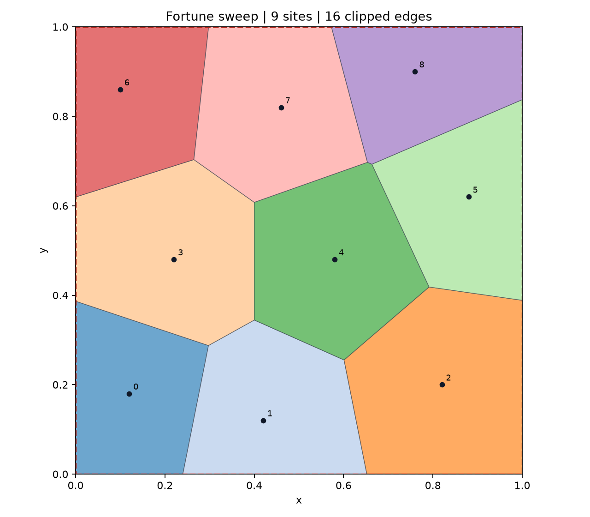

# Fortune Sweep Voronoi

From-scratch Python implementation of Fortune's sweep-line algorithm, with an
AVL beach line, lazy circle-event invalidation, clipped ordered cells, interactive
Matplotlib display and independent geometric validation. This is a personal
project using the supplied course specification as its quality benchmark.



## Status

- 82 automated tests pass on native Windows 11 / Python 3.14.7.
- A separate clean environment installed all pinned dependencies, built the
  package, passed the same suite and produced batch PNG/CSV/JSON output.
- 300 seeded random and 40 tight-cluster configurations passed independent checks.
- At n=10,000, all 19,978 emitted circle vertices and 100 cell queries were checked.
- Native Windows GUI display and Export were observed; real screenshot retained.
- Report PDF and editable source, genuine failure records and measured results included.
- Owner review, subscription-plan disclosure, two AI-interaction screenshots and
  the owner's narrated video remain pending. See REVIEW_CHECKLIST.md.

## Windows quick start

Install Python 3.12 or newer, x64; Python 3.14.7 was verified locally. Enable
Python on PATH in its installer. Internet is needed for the first dependency
installation. Runtime and test dependencies are pinned in requirements.txt.

```bat
git clone https://github.com/broccolize/fortune-sweep-voronoi.git
cd fortune-sweep-voronoi
install.bat
run.bat --input examples\sites.txt --output output\result.png --csv output\cells.csv --json output\diagram.json --bbox 0 0 1 1
run.bat --random 100 --seed 2026 --output output\random.svg --csv output\random.csv
run.bat --interactive
test.bat
```

run.bat also creates the environment on first use if it does not exist. If an
installation was interrupted, run install.bat again. No activation is required.
For a dense preview use --no-labels; labels are enabled by default. --show opens
a batch diagram on screen. Running run.bat without arguments opens the interface.
Use run.bat --help for all arguments. File and random input are mutually exclusive.
--bbox takes xmin ymin xmax ymax, in that order.

## Interactive use

Click inside the axes to add points. Click Compute or double-click to construct.
Clear removes the current input from the canvas. Export writes PNG, CSV and JSON
beside the chosen --output path, or to interactive.png by default. The interface
rebuilds the diagram on Compute; it does not claim to maintain a dynamic Voronoi
structure between clicks. Keep the window open while recording your demonstration.

## Debian WSL or Linux

Keep a separate Linux environment. Do not reuse .venv/Scripts binaries in WSL.
On Debian install python3-venv and, for Tk display, python3-tk using the system
package manager if needed. Then use:

```bash
bash run.sh --random 100 --seed 2026 --output output/random.png --csv output/cells.csv
.venv-wsl/bin/python -m pytest -q
```

Interactive Linux use needs a GUI backend/display (such as WSLg). Batch PNG/SVG
export works without a desktop. Native Windows delivery has been tested directly;
Windows 10 remains a compatibility target, not a claim of a separate test.

## Exports and statistics

CSV rows contain cell/site identity, original duplicate indices, ordered vertex
number, x/y, next endpoint, neighbouring site, edge kind, ray origin and direction.
The last next-endpoint returns to the first vertex. JSON schema version 1 includes
the box, all sites, cells, clipped edges, rays, defining vertex sites and statistics.
Exact duplicates share a cell; nearly coincident sites are kept distinct.

The vertex count includes all emitted finite circle vertices, including ones
outside the clipping box. The edge count describes positive-length visible clipped
edges. trace_edges counts candidate dual adjacencies, including redundant diagonals
at cocircular events. construction_seconds includes normalization, sweep, clipping
and cell assembly; plotting and export are excluded.

## Reproduce validation results and figures

```bat
test.bat --junitxml=evidence\tests-current.xml
.venv\Scripts\python tools\stress.py
.venv\Scripts\python tools\benchmark.py --sizes 100 1000 10000 --repeat 3 --seed 2026
.venv\Scripts\python tools\make_figures.py
```

The benchmark uses separate timing and memory runs. The recorded medians are
0.03294 / 0.40641 / 4.35665 seconds at 100 / 1,000 / 10,000 sites. Traced Python
peaks are 0.70 / 7.38 / 65.08 MiB. Process RSS includes interpreter and tracing
overhead. See results/benchmark.json for raw runs, exact scope and environment.
Measurements vary by machine; these values are observations, not promised speed.

## Report

Read report/report.pdf and edit report/report.md. There are 16 main-body pages,
plus cover and appendices. A source listing is report/source_listing.txt.
On Windows with Times New Roman installed, reproduce the PDF with:

```bat
.venv\Scripts\python -m pip install -r report\requirements.txt
.venv\Scripts\python tools\build_report.py
```

The builder uses A4, 2.5 cm margins, Times New Roman 12 pt and 18 pt leading.
It refuses overflowing page budgets instead of silently shrinking the text.
Figures are original generated outputs/diagrams. The native GUI capture is real.
AI-interaction screenshots and the personal narration must be supplied by the owner.

## Architecture and limits

Optional formatting tools are pinned in requirements-dev.txt. Run
`python -m ruff format --check src tests tools` after installing that file.
The final formatting pass was checked for abstract-syntax equivalence.

The core imports no existing Voronoi/Delaunay implementation. Brute-force distance
scans live only in tests and stress validation. Sweep-generated neighbours alone
supply cell constraints. An AVL tree and heap target O(n log n) time; angle-sorted
half-plane intersection avoids quadratic repeated clipping of a high-degree cell.

Numerical construction uses normalization, exact rational signs/identities for
uncertain decisions, and filtered 80-digit Decimal coordinate construction. This is not a fully certified exact geometry kernel.
Extreme coordinate ratios can be rejected if distinct points collapse on
normalization. Tests include near-coincidence down to 1e-15 in selected cases,
not a proof for every possible IEEE-double input. No external reference Voronoi
comparison has been performed. See docs/problems.md for five actual failures/fixes.

## Project records

The actual verification log is devlog.md. Design, tolerances and evidence are in
docs/. Git follows the owner's requested milestone dates; measurements are stored
with their own actual execution metadata. GPT-6.1 was reported by the owner;
Pi 0.86.0 was inspected but did not generate project code in this session.

The review package is prepared by tools/package_project.py. It includes the
specified report/source/run-script/demo/tests folders and a completeness manifest.
