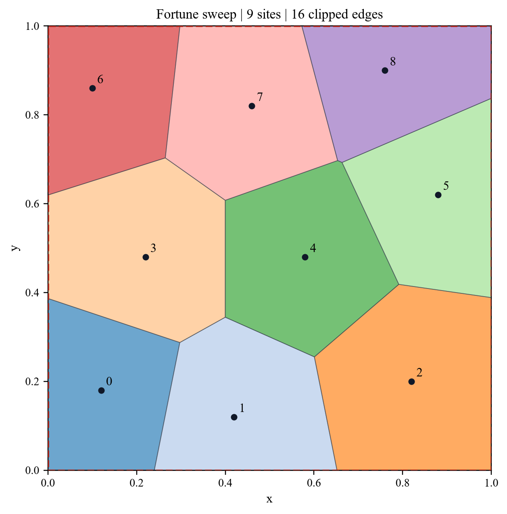

# Fortune Sweep Voronoi

> Optional preview branch: **codex/sweep-animation**. Pointer-following Canvas
> replay is available with `run.bat --animate`; see [the feature notes](docs/animation.md).
> The main project, report and submission ZIP are unchanged. The report copied
> into this branch is the baseline, pending a decision to include the feature.

From-scratch Python implementation of Fortune's sweep-line algorithm, with an
AVL beach line, lazy circle-event invalidation, clipped ordered cells, interactive
Matplotlib display and independent geometric validation. This is a personal
project using the supplied course specification as its quality benchmark.



## Status

- 139 automated tests pass on this optional branch, including the original
  86-test suite, replay controls and Canvas event/presentation checks.
- A separate clean environment installed all pinned dependencies, built the
  package, passed the original 82-test suite and produced batch PNG/CSV/JSON output.
- 300 seeded random and 40 tight-cluster configurations passed independent checks.
- At n=10,000, all 19,978 emitted circle vertices and 100 cell queries were checked.
- Native Windows GUI display and Export were observed; real screenshot retained.
- Report PDF and editable source, genuine failure records and measured results included.
- Genuine ChatGPT and Pi screenshots are included, with unaltered originals and
  provenance records. Pi's separate captured run reports 86 passed in 7.09s.
- Owner review and the owner's narrated video remain pending. See REVIEW_CHECKLIST.md.

## Windows quick start

Install Python 3.12 or newer, x64; Python 3.14.7 was verified locally. Enable
Python on PATH in its installer. Internet is needed for the first dependency
installation. Runtime and test dependencies are pinned in requirements.txt.

```bat
git clone https://github.com/broccolize/fortune-sweep-voronoi.git
cd fortune-sweep-voronoi
install.bat
run.bat --input examples\sites.txt --output output\result.png --csv output\cells.csv --json output\diagram.json --bbox 0 0 1 1
run.bat --random 100 --seed 2026 --output output\random.svg --csv output\random.csv
run.bat --interactive
run.bat --animate --input examples\sites.txt --bbox 0 0 1 1
test.bat
```

run.bat also creates the environment on first use if it does not exist. If an
installation was interrupted, run install.bat again. No activation is required.
For a dense preview use --no-labels; labels are enabled by default. --show opens
a batch diagram on screen. Running run.bat without arguments opens the interface.
Use run.bat --help for all arguments. File and random input are mutually exclusive.
--bbox takes xmin ymin xmax ymax, in that order.

## Interactive use

Click inside the axes to add points. Click Compute or double-click to construct.
Clear removes the current input from the canvas. Export writes PNG, CSV and JSON
beside the chosen --output path, or to interactive.png by default. The interface
rebuilds the diagram on Compute; it does not claim to maintain a dynamic Voronoi
structure between clicks. Keep the window open while recording your demonstration.

Animate opens a self-contained browser viewer. Move the pointer to control the
sweep directly; click to freeze/resume. The browser receives states from the real
Python engine, with no per-pointer Python calls. `--output replay.html` retains
the viewer. `--animation-backend matplotlib` selects the earlier inspector.

## Debian WSL or Linux

Keep a separate Linux environment. Do not reuse .venv/Scripts binaries in WSL.
On Debian install python3-venv and, for Tk display, python3-tk using the system
package manager if needed. Then use:

```bash
bash run.sh --random 100 --seed 2026 --output output/random.png --csv output/cells.csv
.venv-wsl/bin/python -m pytest -q
```

Interactive Linux use needs a GUI backend/display (such as WSLg). Batch PNG/SVG
export works without a desktop. Native Windows delivery has been tested directly;
Windows 10 remains a compatibility target, not a claim of a separate test.

## Exports and statistics

CSV rows contain cell/site identity, original duplicate indices, ordered vertex
number, x/y, next endpoint, neighbouring site, edge kind, ray origin and direction.
The last next-endpoint returns to the first vertex. JSON schema version 1 includes
the box, all sites, cells, clipped edges, rays, defining vertex sites and statistics.
Exact duplicates share a cell; nearly coincident sites are kept distinct.

The vertex count includes all emitted finite circle vertices, including ones
outside the clipping box. The edge count describes positive-length visible clipped
edges. trace_edges counts candidate dual adjacencies, including redundant diagonals
at cocircular events. construction_seconds includes normalization, sweep, clipping
and cell assembly; plotting and export are excluded.

## Reproduce validation results and figures

```bat
test.bat --junitxml=evidence\tests-current.xml
.venv\Scripts\python tools\stress.py
.venv\Scripts\python tools\benchmark.py --sizes 100 1000 10000 --repeat 3 --seed 2026
.venv\Scripts\python tools\make_figures.py
```

The benchmark uses separate timing and memory runs. The recorded medians are
0.03294 / 0.40641 / 4.35665 seconds at 100 / 1,000 / 10,000 sites. Traced Python
peaks are 0.70 / 7.38 / 65.08 MiB. Process RSS includes interpreter and tracing
overhead. See results/benchmark.json for raw runs, exact scope and environment.
Measurements vary by machine; these values are observations, not promised speed.

## Report

Read report/report.pdf. The editable LaTeX source is report/report.tex, with
separate files under report/sections/. Change shared formatting in
report/preamble.tex and references in report/references.bib.
On this Windows computer, build using the existing Debian LaTeX installation:

```bat
.venv\Scripts\python tools\build_report.py --wsl Debian
```

With a complete native MiKTeX/TeX Live installation, omit --wsl Debian.
See report/README.md for one-time font-support preparation and editing guidance.
The document uses A4, 2.5 cm margins, Times New Roman 12 pt and 1.5 spacing,
numbered equations, highlighted code listings, automatic contents and IEEE-style
numbered references. report/report.md is retained only as the legacy draft.
Figures are original generated outputs/diagrams. The native GUI capture is real.
AI-interaction screenshots and the personal narration must be supplied by the owner.

## Architecture and limits

Optional formatting tools are pinned in requirements-dev.txt. Run
`python -m ruff format --check src tests tools` after installing that file.
The final formatting pass was checked for abstract-syntax equivalence.

The core imports no existing Voronoi/Delaunay implementation. Brute-force distance
scans live only in tests and stress validation. Sweep-generated neighbours alone
supply cell constraints. An AVL tree and heap target O(n log n) time; angle-sorted
half-plane intersection avoids quadratic repeated clipping of a high-degree cell.

Numerical construction uses normalization, exact rational signs/identities for
uncertain decisions, and filtered 80-digit Decimal coordinate construction. This is not a fully certified exact geometry kernel.
Extreme coordinate ratios can be rejected if distinct points collapse on
normalization. Tests include near-coincidence down to 1e-15 in selected cases,
not a proof for every possible IEEE-double input. No external reference Voronoi
comparison has been performed. See docs/problems.md for five actual failures/fixes.

## Project records

The actual verification log is devlog.md. Design, tolerances and evidence are in
docs/. Git follows the owner's requested milestone dates; measurements are stored
with their own actual execution metadata. The owner confirmed GPT-6.1 with
ChatGPT Plus. On 17 November 2026, Pi 0.86.0 in Debian WSL used
openai-codex/gpt-6.1-sol to review event invariants and generate four additional
pytest regressions. The desktop assistant reviewed and executed those tests;
the production algorithm was unchanged. The real prompt, response and results
are retained in evidence/pi-review-2026-11-17/.

The review package is prepared by tools/package_project.py. It includes the
specified report/source/run-script/demo/tests folders and a completeness manifest.
