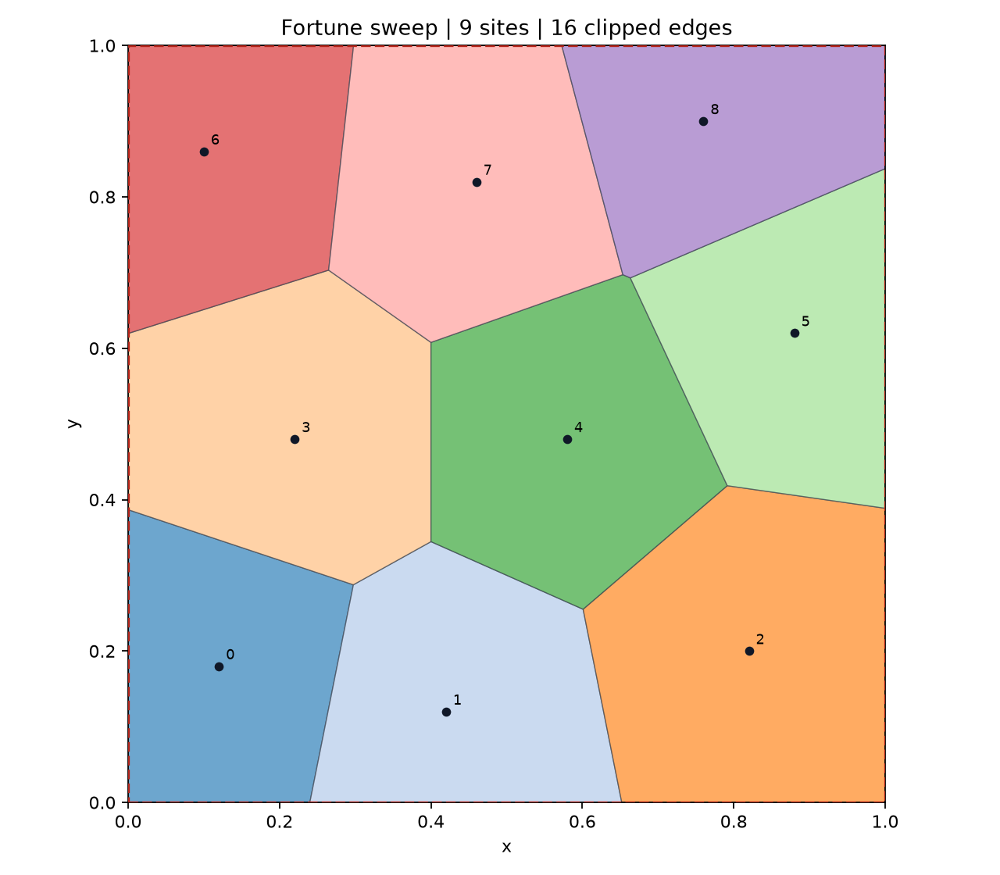
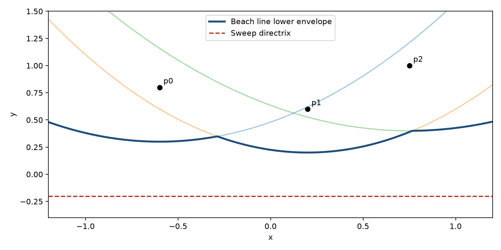
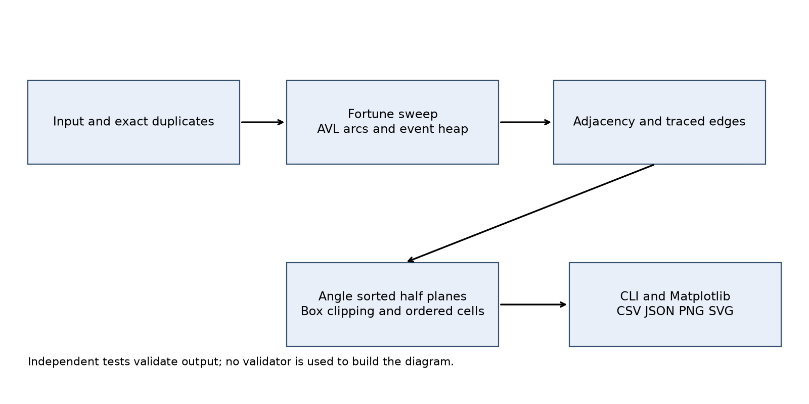
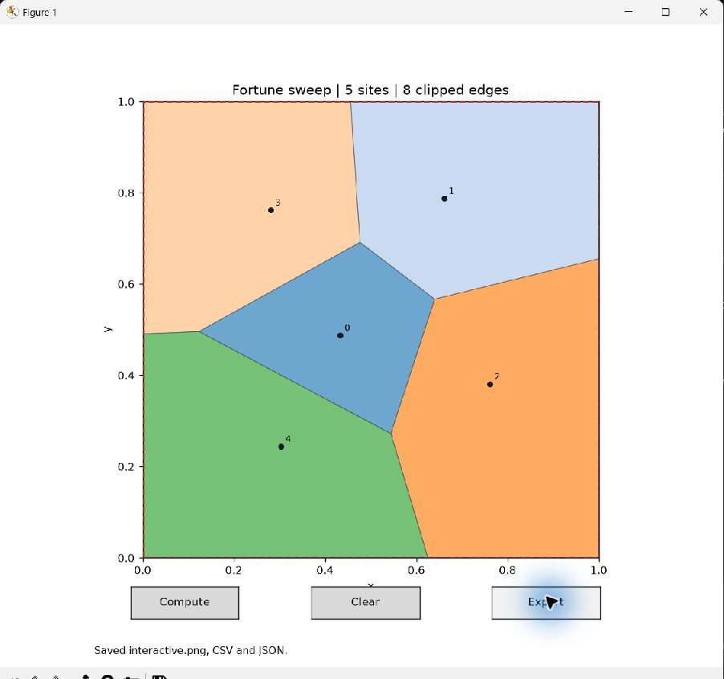
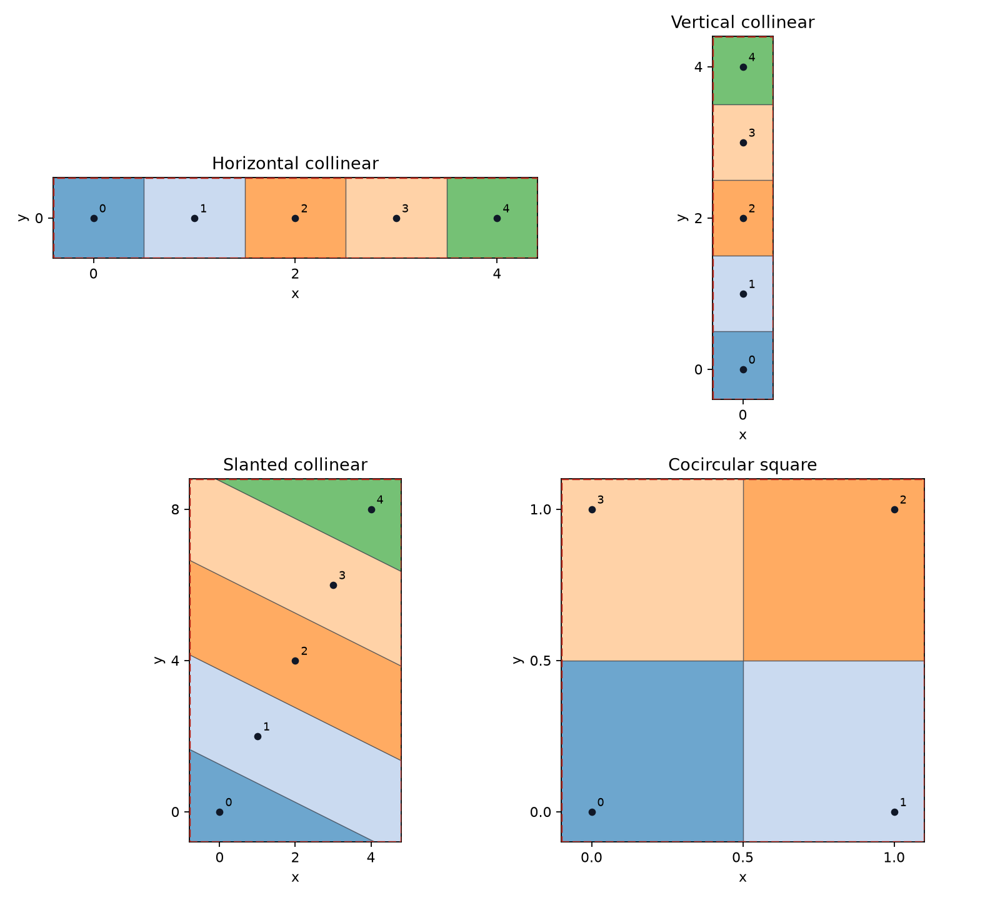
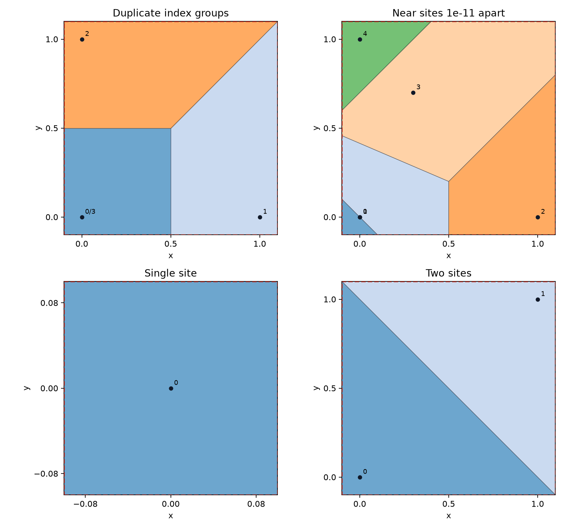
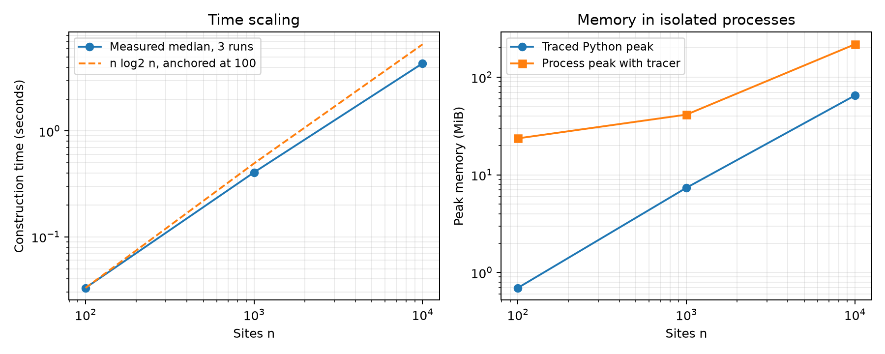
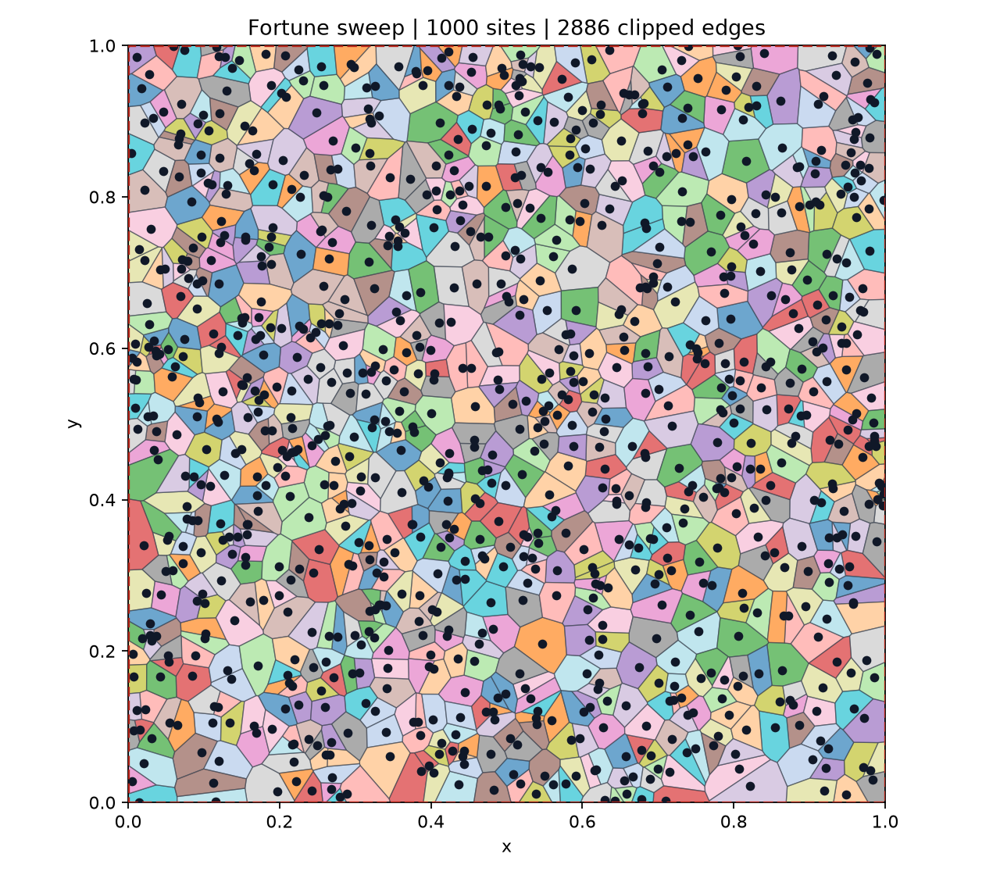

# Fortune Sweep Line Voronoi Diagrams

Personal computational geometry project

Author broccolize

Implementation and validation report

10 November 2026

Quality benchmark Northwestern Polytechnical University Computational Geometry major assignment specification

<!-- PAGE -->

# 1 Introduction and theoretical background

This project constructs planar Voronoi diagrams from a finite set of point sites using a from-scratch Fortune sweep. The implementation includes a balanced beach line, event queue, circle-event invalidation, traced vertices and edges, clipped ordered cells, batch commands and a graphical interface. Independent tests check the geometry of the output rather than judging diagrams by appearance. At the time of this report, 82 automated tests pass and construction has been measured up to 10,000 sites on native Windows.

For a site p, its cell contains every query q whose Euclidean distance to p is no greater than its distance to any other site. Each pairwise comparison defines a half-plane bounded by a perpendicular bisector. The intersection is convex and can extend to infinity. A rectangle turns its visible portion into a finite polygon, without changing which site owns any query inside that rectangle.



The dashed red rectangle is the clipping boundary. Markers and original input indices identify the sites. Shared polygon boundaries represent equal distances. The program distinguishes true circle-event vertices from corners introduced only by clipping.

<!-- PAGE -->

## 1.1 Sweep mechanics and degeneracies

The directrix moves downwards. A processed site and the current directrix define a parabola; the lower envelope of these parabolas is the beach line. Figure 2 illustrates this geometric model, rather than an animation frame captured from the implementation.



A site event inserts a limiting arc and normally splits an existing arc into three. At a circle event, three consecutive arcs meet an empty circle and the middle arc disappears. Its circumcentre becomes a Voronoi vertex. The event is scheduled at the circle's lowest point, not at its centre. Changes to neighbouring arcs can invalidate a pending event before it reaches the front of the queue.

Fortune's original work establishes the sweep approach and its O(n log n) time and O(n) space targets [1]. The present implementation follows the familiar beach-line formulation summarized in the supplied specification. It uses ordinary Python containers and mathematics, not an existing Voronoi or Delaunay implementation.

Degeneracies need explicit policies. Exact duplicates share one cell and retain all original indices. Exactly collinear inputs reduce to consecutive one-dimensional neighbours and parallel bisectors. Equal-height events use limiting arcs. Cocircular events may share one emitted vertex. Near-coincident sites remain distinct, subject to finite-precision representation; no blanket distance threshold silently merges them.

<!-- PAGE -->

# 2 AI tools and development methodology

The owner identifies the selected model as GPT-6.1 in the ChatGPT desktop app, Windows package OpenAI.Codex version 26.1029.7803.0. The subscription plan has not been supplied and must be completed before this report is treated as final disclosure. The actual coding work documented here was produced through this desktop assistant session. Pi 0.86.0 was inspected in Debian 13.7 on WSL 2; no Pi model session generated project code during the recorded work. This distinction avoids attributing contributions to a tool that was merely installed.

The AI contribution covered specification extraction, architecture choices, source generation, test design, diagnosis of genuine failures, performance measurements and report drafting. The owner supplied the project objectives, clarified the personal-project scope, selected the milestone schedule and provided the Git identity. The assignment is used as a quality benchmark rather than represented as an enrolled course submission.

| Development activity | Verification used |
| --- | --- |
| Geometry and circle construction | Singular-limit, translation and equidistance tests |
| AVL beach line | Random insertion/deletion with structural invariants |
| Sweep and cells | Independent ownership, area and empty-circle checks |
| Interfaces | CLI exports, callback tests and native window observation |
| Performance | Repeated timing and isolated memory processes |

Table 1 Verification attached to AI generated work

Prompts were followed by executable checks. The first complete cell suite had three failures. Tight-cluster stress cases then exposed further defects. These were investigated using actual inputs and raw error records; passing pictures were not accepted as sufficient evidence. The development log and problem register preserve what changed and why.

Two authentic prompt-and-response screenshots remain owner-supplied evidence. None has been fabricated. The report source, raw tests and numeric results are already available; the screenshot requirement and personally narrated recording remain separate completion items. Git dates follow the owner's requested milestone schedule, while experiment files record actual execution metadata.

<!-- PAGE -->

# 3 Algorithm design and data structures

The architecture separates construction from validation and presentation. Geometry, event management and the AVL tree use the Python standard library. Matplotlib and its numerical dependencies are used for drawing, not for a hidden Voronoi core. The validators live under tests and are never called to construct cells.



| Component | Main responsibility |
| --- | --- |
| geometry.py | Filtered orientation, circumcentres, breakpoints |
| beachline.py | Stable arc identities and AVL order |
| events.py and circle.py | Priority queue and candidate circle events |
| sweep.py | Site splits, arc removal, vertices and traced edges |
| clipping.py and diagram.py | Neighbour constraints and ordered clipped cells |
| io.py, cli.py, visualize.py | Inputs, exports, batch and interactive display |

Table 2 Implemented module responsibilities

Arc nodes contain tree links, predecessor/successor links, height, site identifier, live state and generation counter. A site can own several arcs; a site identifier is therefore not a unique arc identity. Deletion physically transplants a successor node instead of copying its payload, preserving queued references to other arc objects.

<!-- PAGE -->

## 3.1 Invariants complexity and numerical policy

The beach-line invariant is that the tree's in-order traversal equals the live left-to-right arc sequence, with consistent adjacent links. Search compares a query x against the node's current left and right breakpoints. AVL rotations preserve sequence order. Tests validate parent pointers, stored heights, balance and neighbour links after each randomized update.

The queue invariant is that the next valid event has the greatest remaining sweep height. Heap keys include negative y, event kind, x and a monotonically increasing serial number. Site events precede circle events at equal height. A circle is valid only while its arc is alive and its stored generation equals the arc's current generation. Rescheduling increments that generation; stale entries are discarded when popped.

Each structural update creates only a constant number of candidates. AVL updates and heap operations cost O(log n), giving the intended O(n log n) sweep with O(n) records. Traced adjacencies form a planar graph; hull order distinguishes true rays from zero-length cocircular diagonals. For cell degree k, final intersection sorts k neighbour constraints plus four box constraints and uses a deque. Its cost is O(k log k); summing degrees in the planar graph preserves an O(n log n) overall target. It does not compare each cell with every site.

| Numerical operation | Current policy |
| --- | --- |
| Construction frame | Translate and uniformly scale by input extent |
| Orientation cancellation | Filtered double sign, exact rational fallback |
| Ill-conditioned centre | Decimal construction below relative threshold 1e-8 |
| Near-parallel half-planes | Rebuild coefficients from defining sites in Decimal |
| Clipping membership | Exact rational signs for uncertain corner tests |
| Repeated circle vertices | Exact input-circle identity, not coordinate rounding |

Table 3 Explicit arithmetic policies

These are tested engineering policies, not a proof of exact topology for arbitrary floating-point inputs. Coordinate construction uses fixed 80-digit fallbacks and rounded output, which still have limits. The implementation does not claim the fully certified predicates described in robust-geometry research [2].

<!-- PAGE -->

# 4 Implementation and the AI assisted coding process

The site handler first locates the live arc above the new site. For an ordinary split it keeps the left arc identity, inserts the new site's arc and a right copy of the original site's arc, records their separating edge, then reschedules affected neighbours. Equal-height sites use an adjacent limiting arc instead of dividing by a zero directrix gap.

```python
new, right = Arc(site), Arc(old.site)
self.beach.insert_after(old, new)
self.beach.insert_after(new, right)
self.edge(old.site, site)
for arc in (before, old, new, right, after):
    self.schedule(arc)
```

The circle handler verifies identity and generation before changing topology. It records the vertex on the two disappearing boundaries and on the newly created boundary, removes the middle arc and reschedules the surviving pair. These operations are local even though the output affects three cells.

```python
self.edge(left.site, middle.site, vertex)
self.edge(middle.site, right.site, vertex)
self.edge(left.site, right.site, vertex)
self.beach.remove(middle)
self.statistics["circle_events"] += 1
self.schedule(left)
self.schedule(right)
```

AI-generated code was integrated incrementally. Geometry first passed ten tests, then geometry plus AVL operations passed seventeen. Queue, detection, triangle and cocircular-square checks raised the total to twenty-one. The larger validation suite then contradicted the apparent success of these examples. That failure prompted changes to clipping and numerical construction rather than a claim that the first implementation was complete.

The snippets above are excerpts from the actual source. Complete editable modules and a companion source listing are included in the package. No public implementation was copied into the algorithmic core.

<!-- PAGE -->

## 4.1 Interfaces exports and native display

The file parser accepts one whitespace- or comma-separated pair per line, ignores blank lines and comments, and reports malformed line numbers. Seeded generation uses Python's random generator. Exact duplicates retain their input-index groups. Batch commands print counts and construction timing, then optionally write an image, CSV and JSON.



The interface provides click insertion, double-click or Compute, Clear and Export. Callback tests exercise insertion, computation, clearing and output without relying on physical mouse timing. A native Tk window was also observed and its Export control produced PNG, CSV and JSON files. Figure 4 is a real window capture, not a redrawn mockup. The five-site state in that capture is retained in examples/interactive.json.

Each CSV row gives one ordered vertex and the next endpoint, so closure is explicit. It also identifies the neighbouring site or box boundary and records line/ray information. JSON includes defining sites for vertices and ray origins/directions. Static rendering can use an off-screen backend; interactive rendering needs a working GUI backend [3].

<!-- PAGE -->

# 5 Testing and validation

The automated suite contains 82 passing tests. A fixed seed and explicit inputs make failures reproducible. The tests use a different computation from the constructor: sample queries are located in constructed polygons and their owners are compared with a linear nearest-site scan. Merely returning a brute-force nearest neighbour from a diagram method would not validate the cells, so that shortcut is not used.

| Test family | Cases | Result |
| --- | --- | --- |
| Geometry and singular limits | 11 | Pass |
| AVL structure and search | 7 | Pass |
| Queue and circle-event examples | 4 | Pass |
| Random cell configurations | 25 | Pass |
| Degenerate and clipping families | 12 | Pass |
| Repeatability, scale and invalid data | 5 | Pass |
| Tight clusters and high degree | 14 | Pass |
| Parser, exports, CLI and callbacks | 4 | Pass |

Table 4 Automated results from evidence/tests-current.xml

For every emitted circle vertex in the validation cases, distances to its defining sites are compared and all sites are checked for a strict interior point. Clipping corners are excluded from this property because they need not be centres of empty circles. The tests also compare total cell area with box area; this complements ownership sampling but cannot replace it, as the initial failures demonstrated.

An additional 300 seeded configurations of 10 to 89 sites passed 25 ownership queries each and empty-circle checks; forty more clustered cases also passed. For 100, 1,000 and 10,000 sites, one hundred queries and every emitted circle vertex were independently checked, including 19,978 vertices at the largest size. A separate clean Windows environment installed the pinned dependencies, built the package, passed all 82 tests and generated batch exports. No external Voronoi implementation was used for validation. A separated reference comparison would strengthen future work.

<!-- PAGE -->

## 5.1 Degenerate cases and numerical stress



The three line directions give parallel bisector strips. The square produces
one common circle vertex; a zero-length diagonal is not drawn as a real edge.

<!-- PAGE -->

## 5.2 Duplicate near coincident and minimal inputs



Indices 0/3 in the duplicate example share one cell. In the near-site panel, sites separated by 1e-11 are distinct but cannot be visually resolved at the full plot scale. Automated checks, rather than marker separation, establish their treatment. The adversarial tests additionally place six sites within clusters down to 1e-15 among distant sites. Passing these cases under stated tolerances does not certify every near-degenerate input.

<!-- PAGE -->

# 6 Problems and solutions

## 6.1 Rounded zero length edges

Symptom. The diagonal two-site and nine-site cocircular examples reported holes during cell-ownership sampling, while their total-area checks passed.

Investigation. Consecutive polygon endpoints and their cross products were inspected. Three concurrent constraints had created nearly equal output vertices and a tiny boundary segment.

Root cause. Subtracting rounded equal endpoints gave an arbitrary segment direction. The convex-containment check then treated that segment as an additional, incorrect boundary constraint.

Solution. The final cleanup removes a support only when concurrent(p,q,r) proves exact rational concurrence. An intermediate distance cutoff was rejected after per-site checks found missing tiny cells. Exact circle identities also replace rounded-centre grouping.

Verification. The original failures and six new positive-cell regressions pass. Prevention and lesson. Check every site retains its cell; area and sampled ownership alone can miss microscopic missing cells. See tiny-cell-initial.xml for the later failures.

## 6.2 Close site half plane coefficients

Symptom. A seed-11 cluster at scale 1e-11 produced area 1.439996905390856 for a box of area 1.44.

Investigation. Cluster inputs and polygon intersections were compared with ordinary random cases. The problem appeared when almost parallel bisectors were intersected.

Root cause. Unit-normal coefficients had already lost precision before division by a small intersection determinant. More precision applied only to those rounded coefficients could not recover the missing information.

Solution. HalfPlane retains its defining focus pair. For `abs(det) < 1e-7`, coefficients are rebuilt from those binary coordinates and intersected using 80-digit Decimal arithmetic.

Verification. The seed-11 cluster now passes area, ownership and empty-circle checks. Prevention and lesson. Preserve construction provenance and identify the conditioning of arithmetic operations, not just the final output's finiteness.

<!-- PAGE -->

## 6.3 Predicate reliability versus construction accuracy

Symptom. The initial exponent-15 cluster emitted a centre that failed equidistance to its defining sites. The original failure and input are saved in adversarial-initial.json.

Investigation. The determinant used for the centre was compared with its product magnitudes. Its sign was plausible, but the calculated coordinates remained inaccurate.

Root cause. The original relative fallback threshold of 8e-16 addressed severe sign cancellation. A sign filter does not provide an accuracy guarantee for the division used to construct a circumcentre.

Solution. Circumcentre construction now uses Decimal when the cross product is at most `1e-8 * (abs(ux*vy) + abs(uy*vx))`. This is a separate policy from the orientation predicate.

Verification. All five tight-cluster exponents pass the circle tests. Prevention and lesson. Distinguish decisions about a determinant's sign from coordinate construction. The AI's first implementation conflated the two, and adversarial tests exposed the gap.

## 6.4 A generous epsilon created invalid boundary edges

Symptom. After the precision changes, exponent-13 and exponent-14 clusters still reported a hole at (0.783765456996815, 0.7120393849074937).

Investigation. A corner cell contained a vertex at y=1.100000000000123 despite a clipping maximum of 1.1. A reversed edge about 1.2e-13 long excluded valid interior queries.

Root cause. The original membership allowance of 2e-13 kept an inactive constraint and admitted a corner just outside the rectangle. Relaxing the validator did not repair that polygon.

Solution. The first fix reduced the allowance to 8e-16; final corner_inside uses `sign <= 0 if determinant > 0 else sign >= 0` when the floating result is uncertain. Verification. The two failures saved in tests-adversarial.xml pass afterward. Prevention and lesson. Increasing epsilon is not a universal repair; construction must be rechecked against independent geometric properties.

<!-- PAGE -->

## 6.5 A validator omitted output representation error

Symptom. Translating an otherwise small input near 1e9 caused an equidistance failure under the original fixed 1e-8 validation allowance.

Investigation. The spacing between representable output coordinates was measured. One double-precision ULP near 1e9 is about 1.19e-7, already larger than that validation bound. The constructor calculates locally but must round when it returns world coordinates.

Root cause. The validator assumed that normalization eliminated all scale effects, including final coordinate representation. It also underestimated cross-product uncertainty for extremely short exported edges.

Solution. Circle checks use `tolerance = 1e-8*max(1,r) + 8*coordinate_ulp`. Polygon containment includes endpoint-subtraction uncertainty and a bounding-box rejection to prevent tiny-cell uncertainty from accepting distant queries. These adjustments describe representation error; they do not alter ownership by directly scanning sites inside the polygon test.

Verification. The translation and scaling cases pass. Cluster tests still failed until the distinct construction defects in Sections 6.2 to 6.4 were fixed, showing that the validator change alone did not hide those defects.

Prevention and lesson. A validator is software with its own assumptions. Review its error model and preserve independent checks that can disagree with it. A passing tolerance-based test is evidence within a stated precision regime, not a universal proof.

The five cases above were observed during actual development. Their symptoms, inputs, fixes and regression checks are retained in docs/problems.md and evidence/. Additional environment issues included pip bootstrapping into an unwritable temporary directory and a duplicate dictionary key in the first benchmark script. Those were corrected and are recorded as engineering issues rather than substituted for the five geometric analyses.

<!-- PAGE -->

# 7 Performance analysis and results

Measurements used native Windows 11 x64, Python 3.14.7 and an Intel64 Family 6 Model 165 processor. All sizes used seed 2026 and the unit-square box. The table gives the median of three timed runs, excluding input generation, plotting, export and validation. It includes deduplication, normalization, the sweep, clipping and cell assembly.

| Sites | Median seconds | Python peak MiB | Process peak MiB |
| --- | --- | --- | --- |
| 100 | 0.03294 | 0.70 | 23.67 |
| 1,000 | 0.40641 | 7.38 | 41.42 |
| 10,000 | 4.35665 | 65.08 | 217.48 |

Table 5 Actual benchmark results from results/benchmark.json



Each memory result comes from a fresh process. Tracemalloc starts after input generation and measures Python allocations during construction. Process peak working set includes interpreter, input and instrumentation overhead; it is not the uninstrumented algorithm's incremental memory. Memory and timing runs are separate. Python's tracing facilities support this measurement distinction [4].

Tenfold input increases produced time ratios about 12.34 and 10.72. The allocation peaks grew approximately tenfold, consistent with the intended linear-space structure. These three sizes support the complexity expectation but do not prove an asymptotic bound. Raw per-run values, platform metadata and scope are preserved, so the result can be reproduced without relying on the rounded table.

<!-- PAGE -->

# 8 Critical reflection on AI assisted programming

The assistant was useful for translating the long specification into a concrete checklist, separating modules and rapidly producing executable tests. The AVL choice illustrates a productive interaction: the requirement was not merely to store arcs, but to justify logarithmic operations. Explicit tree and neighbour-link invariants made the proposed structure reviewable and produced tests that inspect actual state after thousands of mutations.

The first plausible output was not reliable enough. Later per-site checks also found missing microscopic cells that area and sampling had missed; exact concurrency and circle identities repaired that loss. Geometry and small sweep examples passed before full cells were tested. A later 59-pass, three-failure result exposed defects invisible in ordinary plots. Still later, tight clusters defeated numerical policies that seemed reasonable on normal-scale input. The assistant's initial treatment of a determinant filter as sufficient for centre accuracy was particularly misleading because the code returned finite, convincing coordinates. This is why code generation and correctness evidence must remain separate activities.

Effective prompts paired a specific invariant with the actual failing input and output. Broad requests for robust geometry tended to produce unexplained tolerances. Relaxing validation did not cure the cluster holes; inspecting a corner beyond the box led to a construction fix. Executable evidence was more useful than an untested, polished explanation.

Verification also needed independence. Nearest-site comparison would be circular if the tested operation simply performed the same brute-force scan as its oracle. Here the test derives ownership from output polygons and compares it with distances calculated separately. Empty-circle, area and structural checks cover different failure modes, and their disagreements helped isolate causes. None is claimed to establish universal correctness alone.

For future work, the next priorities are certified predicates or interval error bounds, stronger randomized campaigns, a separated reference comparison and explicit tests for precision limits. Human review remains necessary: the owner should trace the code, reproduce results, add personal observations to this reflection and record the demonstration in their own words. AI can draft explanations and scripts; it cannot substitute its understanding for the author's ability to defend the implementation.

<!-- PAGE -->

# 9 Conclusion

The project now contains a working, from-scratch Fortune sweep with an AVL beach line, event invalidation, traced edges and clipped ordered cells. It provides reproducible input modes, machine-readable exports, static visualization and a native interactive window. Eighty-two automated tests and additional seeded checks pass. Actual benchmarks reach 10,000 sites with time and allocation growth consistent with the intended O(n log n) and O(n) targets.

The principal limitations are finite-precision topology beyond the tested regimes, the absence of external reference cross-validation and the need for broader platform verification. Windows 11 was exercised; Windows 10 compatibility is a target, not a tested claim. The report's remaining evidence items are the exact subscription disclosure, two authentic AI interaction screenshots and the owner's narrated walkthrough. These should be completed without inventing a history, result or recording.

The software and report are designed to be explained as well as run. The strongest contribution is the combination of a genuine sweep implementation with independent checks and retained failure evidence. The final demonstration should focus on those mechanisms and their practical limits.

## References

[1] S. Fortune, A sweepline algorithm for Voronoi diagrams, Algorithmica, vol. 2, pp. 153-174, 1987. DOI 10.1007/BF01840357. https://link.springer.com/article/10.1007/BF01840357

[2] J. R. Shewchuk, Adaptive Precision Floating-Point Arithmetic and Fast Robust Geometric Predicates, Discrete and Computational Geometry, vol. 18, pp. 305-363, 1997. https://www.cs.cmu.edu/~quake/robust.html

[3] Matplotlib developers, Backends, Matplotlib documentation. https://matplotlib.org/stable/users/explain/backends.html

[4] Python Software Foundation, tracemalloc, Python 3.14 documentation. https://docs.python.org/3.14/library/tracemalloc.html

<!-- PAGE -->

# Appendix A Source and reproduction materials

The complete source is supplied under 02_SourceCode/src/fortune in the review package, with a companion searchable plain-text source listing in 01_Report/source_listing.txt. The pytest suite is under tests/. The Markdown report source and the PDF builder are editable and included. Figures are reproduced by tools/make_figures.py from the program and the recorded benchmark data.



This dense example uses seed 2026 and the unit square. Labels are intentionally hidden for this preview; the CLI displays them by default. Construction statistics and machine-readable output remain independent of the drawing density.

<!-- PAGE -->

# Appendix B Evidence still requiring the owner

Capture two real screenshots showing both a substantive prompt and its response. Suitable interactions concern the beach-line invariant and an actual numerical failure/fix. Use the genuine app view and preserve originals; do not turn this report's prose into a supposed conversation screenshot. Add the image filenames and captions to docs/evidence.md, then update the report layout.

Record a narrated demonstration no longer than five minutes using the script in 04_Demo/. Show batch input/export, interactive input, architecture, both invariants and three concrete design decisions. Supply the subscription plan and confirm the displayed model as GPT-6.1. Pi should remain described as inspected only unless its actual contribution changes.

The report has sixteen main-body pages, from Section 1 through the references, before this appendix. Figures are original program outputs or original explanatory diagrams. No interaction screenshot or personal narration has been fabricated.
